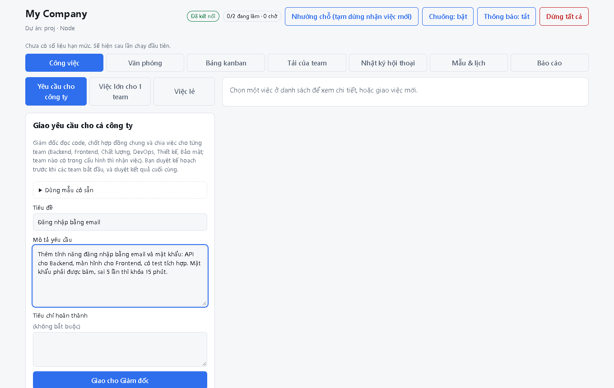
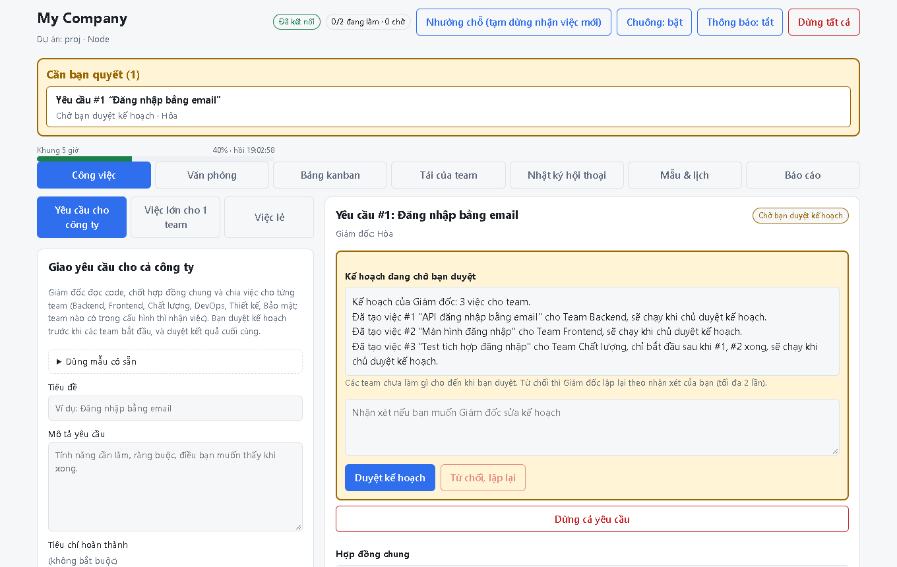
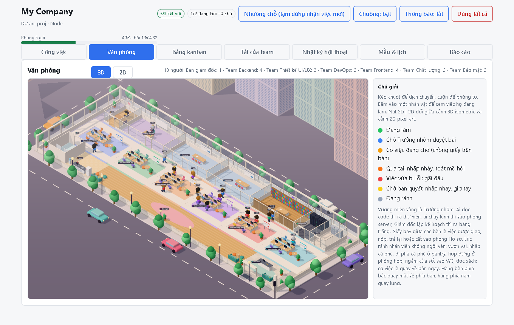
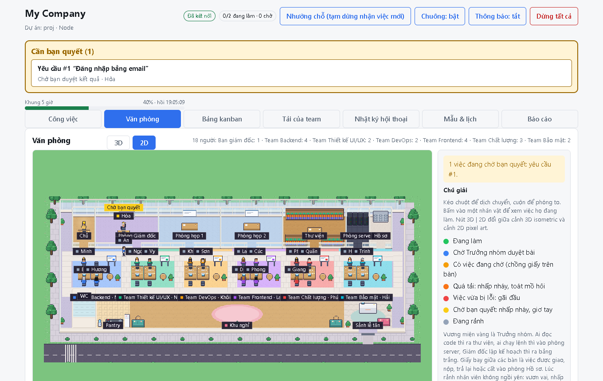
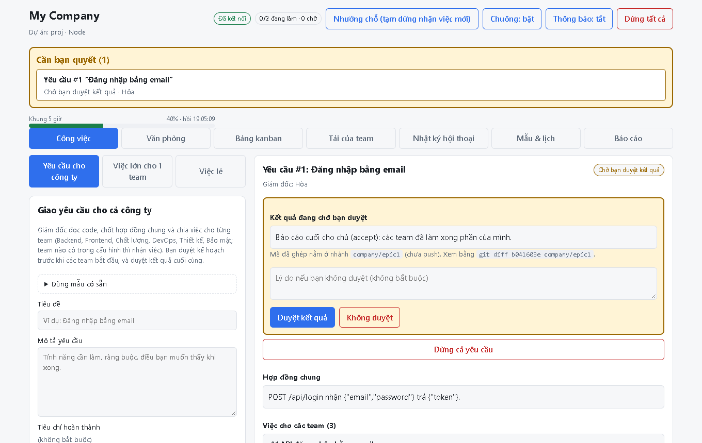
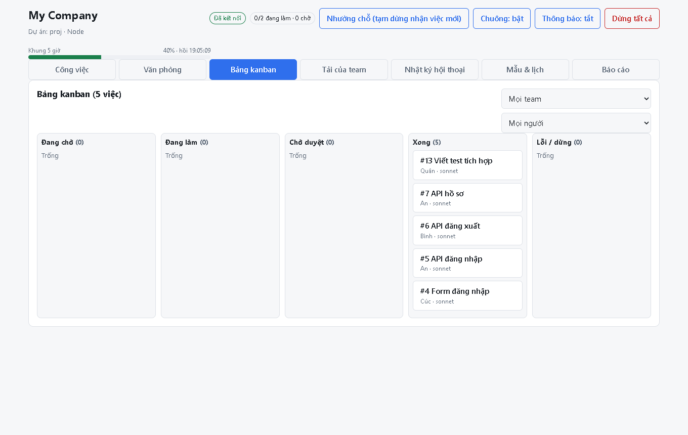
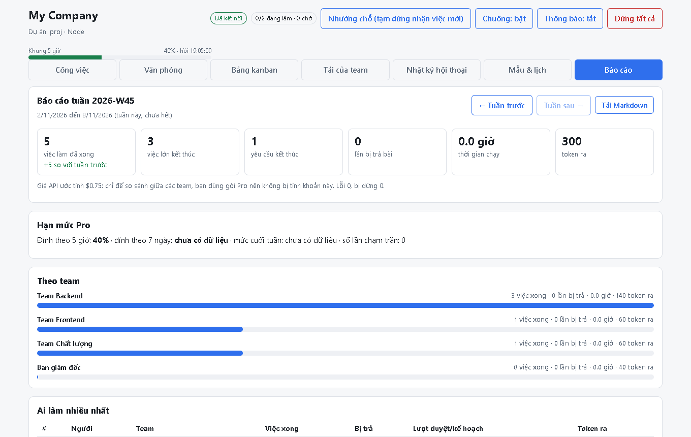
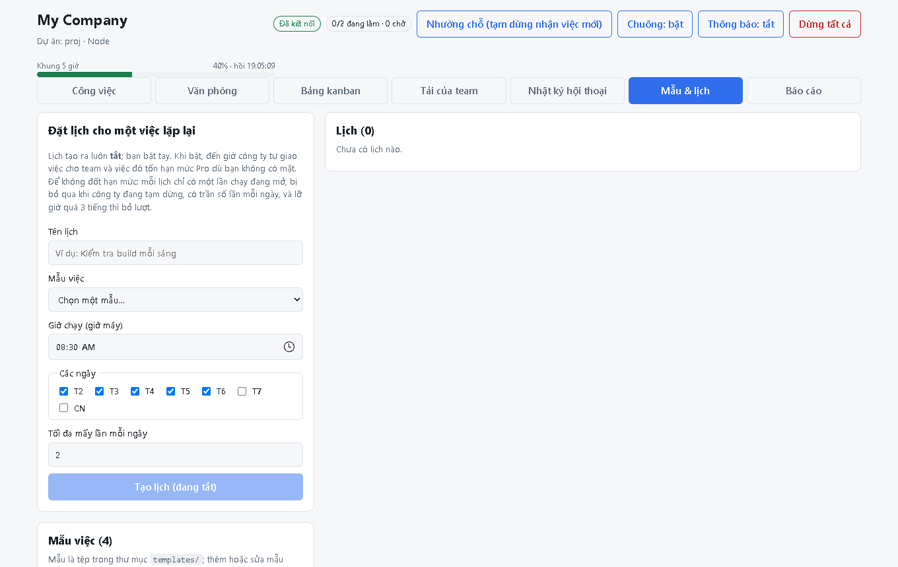
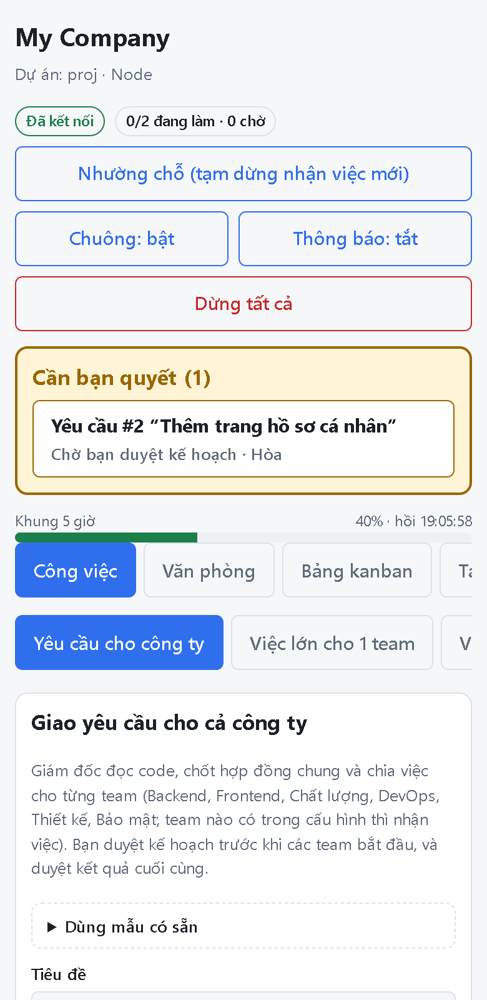

# My Company

[](LICENSE)

Công ty ảo chạy bằng Claude Code (gói Pro). Bạn giao việc, các "nhân viên" (mỗi người một tiến trình `claude -p` với vai trò, model và skill riêng) làm trong nhánh git riêng, bạn xem kết quả trên giao diện web.


*Văn phòng 3D chạy thật: nhân viên đi đọc code ở thư viện, vào phòng server chạy lệnh, giấy bay giữa các bàn khi việc được giao và nộp. (Ảnh chụp với Claude giả, để minh họa mà không tốn hạn mức.)*

Giao **việc lẻ** cho một nhân viên, **việc lớn** cho một team (Trưởng nhóm chia việc, duyệt bài, gộp nhánh), hoặc **yêu cầu cho cả công ty** (Giám đốc chốt hợp đồng chung và chia việc cho các team). Không có gì được push lên git: bạn xem kết quả rồi tự quyết.

## Yêu cầu

- Node.js 22.13 trở lên, git, Claude Code đã đăng nhập bằng tài khoản **claude.ai gói Pro**.
- Không cần và không dùng khóa API. Công cụ gỡ `ANTHROPIC_API_KEY` khỏi mọi tiến trình `claude` nó chạy.

## Bắt đầu nhanh

**Bước 1. Cài vào dự án của bạn.** Dự án phải là git repo và đã có ít nhất một commit.

```
cd <thư mục dự án của bạn>
git clone https://github.com/tuan2304/my-comany.git .my-company
cd .my-company
npm install
npm run init
```

`npm run init` ẩn công cụ khỏi git của dự án và tạo `local/project.md` (bản nháp hồ sơ dự án).

**Bước 2. Sửa hồ sơ dự án.** Mở `local/project.md`, ghi đúng công nghệ, thư mục mỗi team được sửa (`folders`), và các lệnh nhân viên được chạy (`allowed_commands`, ví dụ `npm test`). Chưa khai lệnh thì nhân viên không chạy được lệnh nào.

**Bước 3. Kiểm tra môi trường.**

```
npm run doctor
```

Mọi dòng phải đạt (có `claude` trong PATH, đã đăng nhập, `node` trong PATH cho hook chặn thư mục...).

**Bước 4. Chạy.**

```
npm run start
```

Mở http://localhost:4310. Gốc dự án là thư mục cha của `.my-company/`; chạy ở chỗ khác thì thêm `--project <thư mục>` hoặc đặt `COMPANY_PROJECT_ROOT`.

## Cách dùng từng bước

Ví dụ: bạn muốn thêm tính năng đăng nhập bằng email.

### 1. Giao yêu cầu

Tab **Công việc**, chọn **Yêu cầu cho công ty**. Điền tiêu đề, mô tả điều bạn muốn và tiêu chí hoàn thành, rồi bấm **Giao cho Giám đốc**. (Việc nhỏ chỉ cần một team hoặc một người thì chọn **Việc lớn cho 1 team** hoặc **Việc lẻ**; có thể bấm **Dùng mẫu có sẵn** để điền nhanh.)



### 2. Duyệt kế hoạch (điểm dừng 1)

Giám đốc đọc code, chốt hợp đồng chung (đường dẫn API, dữ liệu vào ra, mã lỗi) và chia việc cho các team. **Chưa duyệt thì chưa ai làm gì.** Đọc kế hoạch rồi bấm **Duyệt kế hoạch**, hoặc ghi nhận xét và bấm **Từ chối, lập lại** (Giám đốc lập lại, tối đa 2 lần).



### 3. Xem công ty làm việc

Sang tab **Văn phòng**. Mỗi nhân viên chạy trong worktree và nhánh git riêng; trên màn hình bạn thấy ai đang đọc code, chạy lệnh, sửa file, chờ duyệt bài. Nút **3D | 2D** đổi kiểu vẽ. Bấm vào một người để xem việc của họ.





Các tab khác cho cùng dữ liệu theo cách khác: **Bảng kanban**, **Tải của team**, **Nhật ký hội thoại** giữa các tầng.

### 4. Duyệt kết quả (điểm dừng 2)

Khi mọi team xong, kết quả được ghép vào nhánh `company/epic<số>`. Giám đốc đọc code, chạy test và báo cáo. Bạn xem báo cáo, bấm **Duyệt kết quả** hoặc **Không duyệt** (kèm lý do).



### 5. Lấy kết quả về dự án

Công cụ **không bao giờ push**. Xem thay đổi và gộp bằng git như bình thường:

```
git diff main company/epic<số>        # xem
git merge company/epic<số>            # lấy về nếu ưng ý
```

(Việc lớn dùng nhánh `company/job<số>`, việc lẻ dùng `company/<tên>-task<số>`.)

### Khi có thứ cần bạn

Khối **Cần bạn quyết** ở đầu trang liệt kê kế hoạch hoặc kết quả đang chờ, việc có xung đột hay vượt giới hạn. Tiêu đề tab hiện số việc chờ và có tiếng chuông nhẹ. Hết hạn mức Pro thì cả công ty nghỉ, tới giờ hạn mức hồi thì tự làm tiếp.

| | |
|---|---|
|  |  |
| Bảng kanban | Báo cáo tuần (không tốn hạn mức) |
|  |  |
| Mẫu việc và việc định kỳ | Duyệt việc từ điện thoại ([hướng dẫn](#dùng-từ-xa-bằng-điện-thoại-tailscale--pin)) |

## Cách hoạt động

- Mỗi việc chạy trong **worktree và nhánh riêng** (`company/<tên>-task<số>`) đặt ở thư mục anh em `<tên-dự-án>-worktrees/`. Công cụ tự commit khi xong và **không bao giờ push**. Xem kết quả bằng `git diff main company/<tên>-task<số>`.
- Nhân viên chỉ chạy được các lệnh Bash nằm trong `allowed_commands` của hồ sơ dự án. Chưa có hồ sơ thì không chạy được lệnh nào.
- **Chặn cứng thư mục:** nhân viên chỉ sửa được trong thư mục của team khai ở `folders` của `local/project.md` (hook `server/path-guard.mjs`). Không ai đọc hay sửa được `.env`, `.git` hay file ngoài worktree. Hook gọi lệnh `node`, nên `node` phải có trong PATH (`npm run doctor` kiểm tra).

### Yêu cầu cho cả công ty

1. Bạn giao một **yêu cầu** (tab "Yêu cầu cho công ty"). **Giám đốc** (agent chỉ đọc) đọc code, chốt **hợp đồng chung** nếu yêu cầu cắt ngang nhiều team (đường dẫn API, dữ liệu vào ra, mã lỗi), rồi giao việc cho các team có trong cấu hình (xem bảng team bên dưới). Việc cần kết quả đã ghép của team khác (test tích hợp, rà soát bảo mật) khai `depends_on` các việc kia; việc thiết kế giao diện làm trước và việc Frontend khai `depends_on` nó.
2. **Điểm dừng 1: bạn duyệt kế hoạch.** Chưa duyệt thì chưa team nào làm gì. Từ chối kèm nhận xét thì Giám đốc lập lại (tối đa 2 lần).
3. Backend và Frontend làm **song song** (mỗi team chạy như "việc lớn" bên dưới). Chất lượng bắt đầu sau, trên **mã đã ghép** của hai team kia.
4. Kết quả của cả ba team được ghép vào `company/epic<số>`. Giám đốc đọc code, chạy lệnh test và báo cáo; có lỗi thì được giao **một đợt làm lại**.
5. **Điểm dừng 2: bạn duyệt kết quả.** Không có gì được push.

Team cần có `teams/management/` (Giám đốc, vai trò `director`) và ít nhất một team có Trưởng nhóm và nhân viên. Hồ sơ dự án nên khai `folders` cho từng team: Trưởng nhóm chỉ giao việc trong thư mục của team mình.

Các team gửi kèm (mỗi team là thư mục trong `teams/`; thân tệp `team.md` là **mô tả phạm vi** mà Giám đốc đọc qua `get_company_overview` để biết khi nào giao việc cho team đó, nên thêm team mới không cần sửa code):

| Team | Người | Làm gì | `folders` gợi ý |
|------|-------|--------|-----------------|
| Backend | Minh (lead), An, Bình, Hương | API, cơ sở dữ liệu, migration | `src/server`, `supabase` |
| Frontend | Lan (lead), Cúc, Dũng, Phong | Giao diện | `src/app`, `src/components` |
| Chất lượng | Phúc (lead), Quân, Giang | Test tích hợp và e2e trên mã đã ghép | `test` |
| DevOps | Khôi (lead), Sơn | Chuẩn bị CI/CD, Dockerfile, cấu hình môi trường dạng **tệp**. **Không triển khai**, không chạm hạ tầng thật | `.github`, `infra`, `Dockerfile` |
| Thiết kế UI/UX | Ngọc (lead), Vy | **Đặc tả** thiết kế (Markdown, token), không viết code giao diện; Frontend làm theo | `design`, `docs/design` |
| Bảo mật | Hải (lead), Trinh | Rà soát code đã ghép và viết báo cáo; **không sửa code chính** | `docs/security` |

Team Bảo mật dùng skill `differential-review` (Trail of Bits, giấy phép CC BY-SA 4.0, chỉ gồm tài liệu Markdown) và `sharp-edges`. Skill đó gợi ý dùng `git log`, `git blame`; hồ sơ dự án mặc định chỉ cho `git status` và `git diff`, nên muốn người rà soát xem được lịch sử git thì thêm `git log` và `git blame` vào `allowed_commands` trong `local/project.md` (chỉ đọc nên an toàn). Ba skill Trail of Bits còn lại trong kế hoạch ban đầu (`static-analysis`, `supply-chain-risk-auditor`, `insecure-defaults`) **không được nạp**: chúng cần CodeQL, Semgrep hoặc Python có mạng mà nhân viên không chạy được (hoặc không có SKILL.md để nạp).

Giao diện còn có **bảng kanban** (lọc theo team, người), **bảng tải team**, **nhật ký hội thoại** giữa các tầng và **văn phòng 3D**.

### Văn phòng 3D

Mở tab "Văn phòng": kéo chuột để dịch chuyển, cuộn để phóng to, bấm vào một người để xem việc của họ. Nút **3D | 2D** ở đầu khung đổi giữa hai kiểu vẽ (nhớ lựa chọn trong trình duyệt; không có WebGL thì tự dùng 2D). **3D** là cảnh isometric trực giao (camera nhìn chéo từ góc trước phải, không xoay) với nhân vật chibi đầu to, đồ đạc bo tròn, bóng đổ mềm, ánh sáng ấm, và cả khu phố quanh tòa nhà (đường, vạch qua đường, xe, đèn giao thông, cây, nhà xa có cửa sổ sáng đèn ban đêm). **2D** là pixel art nhìn từ trên xuống, 16 px = 1 mét, phóng to không làm mờ, có ban đêm. Cả hai kiểu vẽ dùng chung một bộ mô phỏng nên ai ở đâu, đang làm gì đều giống hệt nhau. Sơ đồ là **một tầng văn phòng đủ chức năng**: **dải sau** là các phòng kính có cửa mở ra lối đi (Chủ, Phòng Giám đốc có bảng trắng, hai phòng họp, Thư viện, Phòng server, phòng Hồ sơ); **giữa** là không gian làm việc mở, mỗi team một khu thảm màu riêng, bàn xếp thành **cụm bốn bàn đối mặt nhau** (hàng bắc quay mặt về phía camera, hàng nam quay lưng), có bàn trống ở chỗ chưa có người, tấm ngăn thấp giữa hai hàng và góc họp có bảng trắng đứng, bàn tròn, cây xanh; **dải trước** là WC, pantry (quầy cà phê, tủ lạnh, bình nước), khu nghỉ có sofa, và sảnh lễ tân có cửa vào. Người đi bộ đi trên mạng lối đi (hai lối ngang và các lối dọc): từ chỗ ngồi đi ngược về phía lưng ghế ra lối đi, từ phòng đi qua cửa; không ai đi xuyên tường hay đụng bàn ghế. Sơ đồ lấy từ cấu hình team (`teams/`), nên thêm người hoặc thêm team thì khu tự co giãn. Vương miện vàng là Trưởng nhóm.

Văn phòng phản ánh công việc thật, không cần mở bảng việc:

| Điều xảy ra | Cảnh trong văn phòng |
|-------------|----------------------|
| Bạn giao yêu cầu / việc lớn / việc lẻ | Tờ giấy bay từ bàn Chủ tới Giám đốc, Trưởng nhóm hoặc nhân viên |
| Giám đốc giao việc cho team, Trưởng nhóm chia việc | Giấy bay từ Giám đốc tới Trưởng nhóm, từ Trưởng nhóm tới từng nhân viên |
| Giám đốc lập kế hoạch | Giám đốc ra bảng trắng, các phần việc theo màu team hiện dần |
| Nhân viên đọc code (Read, Grep, Glob) | Đi ra thư viện, bóng nói "Đọc app.ts" |
| Nhân viên chạy lệnh (Bash) | Vào phòng server, bóng nói "Chạy npm test" |
| Nhân viên sửa file | Ngồi gõ phím, bóng nói "Sửa login.ts" |
| Hàng chờ của một người | Chồng giấy trên bàn cao dần theo số việc đang chờ |
| Người chạm trần tải (1 làm + 2 chờ) | Đèn cam nhấp nháy, toát mồ hôi |
| Nộp bài, bị trả lại | Giấy xanh bay tới bàn Trưởng nhóm; giấy đỏ bay ngược về nhân viên |
| Nhân viên hỏi Trưởng nhóm hoặc đồng nghiệp | Giấy vàng bay tới người được hỏi; trả lời xong thì giấy tím bay lại. Người hỏi giơ tay chờ, người trả lời đứng đọc code |
| Việc vừa lỗi | Đèn đỏ, nhân viên gãi đầu, bóng nói "Việc bị lỗi" (tắt sau 15 phút hoặc khi nhận việc mới) |
| Kế hoạch hoặc kết quả chờ bạn duyệt, việc cần bạn xử lý | Giám đốc (hoặc Trưởng nhóm) giơ tay, đèn vàng nhấp nháy, đèn trên bàn Chủ nhấp nháy |
| Việc, việc lớn, yêu cầu xong | Giấy xanh lá bay vào tủ ở phòng Hồ sơ, tóe vài đốm sáng |
| Hết hạn mức Pro | Cả công ty ra khu nghỉ; bảng hiệu đếm ngược tới lúc hạn mức hồi, hết giờ thì mọi người về bàn |
| **Không có việc gì** | Nhân viên không ngồi yên: tại bàn thì vươn vai, nhấp cà phê, nhìn quanh; lúc thì đi pha cà phê ở pantry, họp đứng ở phòng họp, ngắm cửa sổ, vào WC, đọc sách ở thư viện, ra khu nghỉ. Không quá 40% số người ra ngoài cùng lúc; có việc được giao là bỏ dở và về bàn ngay |

Đèn trên bàn: xanh lá đang làm, xanh dương chờ Trưởng nhóm duyệt bài, cam có việc đang chờ, cam nhấp nháy quá tải, đỏ vừa lỗi, vàng nhấp nháy chờ bạn quyết, xám rảnh.

**Thông báo:** khi có thứ chờ chính bạn, tiêu đề tab hiện "(2) Cần bạn quyết · My Company" và có một tiếng chuông nhẹ cho việc *mới* (không rung chuông cho thứ đã chờ sẵn lúc bạn mở trang). Nút "Chuông" ở góc trên bật hoặc tắt tiếng, lựa chọn được nhớ trong trình duyệt. Hệ điều hành bật "giảm chuyển động" thì nhân vật dịch chuyển tức thì, giấy không bay, đèn không nhấp nháy.

### Việc lớn cho một team

1. Bạn giao một **việc lớn** cho team (tab "Việc lớn cho team"). **Trưởng nhóm** (agent chỉ đọc) đọc code, xem tải của từng người rồi chia thành các việc con bằng công cụ `assign_to_member`.
2. Các nhân viên làm **song song**, mỗi người một nhánh riêng. Mỗi người tối đa 1 việc đang làm và 2 việc chờ; việc con phải khai `files` và không được chồng lấn nhau.
3. Mỗi bài nộp được Trưởng nhóm **duyệt** (`approve`) hoặc **trả lại** (`reject` kèm nhận xét; nhân viên làm tiếp đúng phiên cũ). Tối đa 2 lần trả; quá thì việc con bị đánh dấu chưa đạt.
4. Khi mọi việc con xong, các nhánh đã duyệt được **gộp** vào `company/job<số>`. Có xung đột hoặc việc con chưa đạt thì việc lớn ở trạng thái "Cần bạn xem". Không có gì được push.

### Nhân viên hỏi nhau

Nhân viên đang làm việc có ba công cụ hỏi (qua MCP của công ty): `ask_lead` (hỏi Trưởng nhóm), `ask_colleague` (hỏi một đồng nghiệp cùng team), `call_meeting` (hỏi cùng một câu cho Trưởng nhóm và tối đa 2 đồng nghiệp, mỗi người trả lời riêng). Lời nhắc dặn chỉ hỏi khi **vướng thật** (đề bài mâu thuẫn, không đoán được từ code), không hỏi để xin duyệt hay thăm dò.
- **Không chờ trong tiến trình**: `claude -p` không chờ được, nên sau khi hỏi nhân viên kết thúc lượt của mình. Việc chuyển sang trạng thái **"Chờ trả lời"** (chưa nộp bài, chưa commit, vẫn tính vào tải của người đó). Mỗi người được hỏi nhận một lượt **trả lời** ngắn: chỉ đọc code (Read, Grep, Glob) trong thư mục làm việc của người hỏi, không công cụ MCP, không Bash, tối đa 8 lượt và 5 phút. Lượt trả lời không phải chờ người được hỏi xong việc dài của họ. Có đủ câu trả lời thì nhân viên được gọi lại bằng `--resume` kèm các câu trả lời.
- **Không ai bị kẹt**: người trả lời lỗi, treo quá 5 phút, bị dừng hay trả lời rỗng thì câu hỏi tính là "không trả lời được" và người hỏi tự quyết theo tiêu chí, ghi giả định vào "Điều còn dang dở". Dừng việc đang chờ thì mọi câu hỏi mở bị hủy và lượt trả lời dừng theo. Máy chủ khởi động lại giữa chừng thì tự khớp lại câu hỏi với các lượt trả lời đã kết thúc.
- **Giới hạn do máy chủ ép**: 2 lần hỏi mỗi việc (một cuộc họp tính một lần), 600 ký tự mỗi câu, chỉ hỏi người cùng team, không tự hỏi mình, khóa bí mật trong câu hỏi bị che. Mã thông báo của nhân viên chỉ gọi được ba công cụ hỏi, hết hiệu lực khi lượt chạy kết thúc.
- Câu hỏi và trả lời hiện trong nhật ký hội thoại và trong lịch sử của việc; báo cáo tuần đếm lượt trả lời riêng, không lẫn vào lượt của Trưởng nhóm.

Hồ sơ dự án có thể khai `worktree_links: [node_modules]` để nối thư mục phụ thuộc của dự án vào mỗi worktree (mặc định là `node_modules`, không bị commit).
- **Độ khó tự động:** mặc định hệ thống tự đánh giá độ khó của việc (một lần gọi `haiku` nhỏ) rồi chọn model: Đơn giản dùng `haiku`, Bình thường theo vai trò, Khó dùng `opus`. Việc hết số lượt mà chưa xong thì tự nâng một bậc và làm tiếp. Bạn có thể ép một mức khi giao việc. Không có model `fable`.
- Tối đa 2 agent chạy cùng lúc (`COMPANY_MAX_CONCURRENT`), mỗi nhân viên một việc một lúc.
- **Hết hạn mức Pro:** việc đang dở được lưu, cả công ty nghỉ đến giờ hạn mức hồi (đọc từ sự kiện `rate_limit_event`), rồi tự làm tiếp bằng `--resume`. Không dùng API.
- Máy chủ chỉ nghe ở `127.0.0.1` và từ chối yêu cầu có `Host` hoặc `Origin` lạ.

### Mẫu việc và việc định kỳ

Tab **"Mẫu & lịch"** và ô **"Dùng mẫu có sẵn"** trong các form giao việc.
- **Mẫu việc** là tệp `templates/<id>.md` (frontmatter: `name`, `kind: epic|job`, `team` cho job, `fields` là các ô cần điền, `title`, `acceptance`; thân tệp là nội dung giao việc, có chỗ điền `{{khóa}}`). Có sẵn bốn mẫu: Sửa lỗi, Viết tính năng, Viết báo cáo hoặc tài liệu, Kiểm tra build và test. Mẫu riêng của bạn đặt trong `local/templates/` (cùng tên thì ghi đè mẫu gốc; mẫu hỏng bị bỏ qua và báo lỗi, không làm hỏng mẫu khác). Giá trị bạn nhập không bao giờ bị diễn giải lại như mẫu.
- **Việc định kỳ**: chọn mẫu, giờ chạy (giờ máy), các thứ trong tuần, tối đa mấy lần mỗi ngày. **Lịch tạo ra luôn tắt**, bạn bật tay. Khi bật, đến giờ công ty tự giao việc và việc đó tốn hạn mức Pro dù bạn không có mặt, nên có các chốt: mỗi lịch chỉ có **một lần chạy đang mở** (lần trước chưa xong hoặc đang chờ bạn xem thì không giao thêm), **bỏ qua khi công ty đang tạm dừng** (hết hạn mức hoặc bạn bấm nhường chỗ), **trần số lần mỗi ngày** (mặc định 2), lỡ giờ vì máy tắt thì **chạy bù một lần** nếu còn trong 3 giờ (quá thì bỏ lượt, không bù dồn), giao lỗi thì ghi lại và thử lại sau 10 phút. Mẫu kiểu việc lớn giao thẳng cho team; mẫu kiểu yêu cầu vẫn dừng ở bước chờ bạn duyệt kế hoạch. Máy chủ phải đang chạy thì lịch mới chạy.

### Báo cáo tuần

Tab **"Báo cáo"** (và `GET /api/report?week=2026-W45`, thêm `&format=md` để tải Markdown). Tuần theo chuẩn ISO (thứ Hai đến Chủ nhật, giờ máy); việc tính vào tuần chứa lúc nó kết thúc. Báo cáo chỉ đọc dữ liệu đã có nên không tốn hạn mức: số việc xong, bị trả bài, lỗi, thời gian chạy, token, theo từng team và từng người (xếp hạng "ai làm nhiều nhất" chỉ tính việc làm của nhân viên; lượt lập kế hoạch và duyệt bài của Trưởng nhóm, Giám đốc đếm riêng), so với tuần trước, cùng mức dùng hạn mức Pro. "Giá API ước tính" chỉ để so sánh giữa các team, bạn dùng gói Pro nên không bị tính khoản đó. Mức dùng hạn mức được ghi từ khi có chức năng này (mỗi 10 phút một mẫu, và luôn ghi lúc chạm trần hoặc hết chặn), nên các tuần trước đó hiện "chưa có dữ liệu hạn mức".

### Dùng từ xa bằng điện thoại (Tailscale + PIN)

Mặc định công ty chỉ nghe ở `127.0.0.1` nên chỉ trình duyệt trên chính máy này vào được. Muốn duyệt kế hoạch hoặc xem tiến độ từ điện thoại, dùng **Tailscale** (mạng riêng, HTTPS có sẵn). Từ xa có thể duyệt việc rồi chạy mã trên máy bạn, nên có hai lớp chắn: chỉ thiết bị trong mạng Tailscale của bạn tới được, và phải nhập **PIN**.

Máy chủ mở **hai cổng riêng**: cổng chính (4310) chỉ cho trình duyệt trên máy này và không cần PIN; cổng từ xa (4311) luôn đòi PIN. Tailscale **phải trỏ vào cổng từ xa**, không phải cổng chính. Làm một lần:

1. Cài Tailscale trên máy tính và điện thoại, đăng nhập cùng một tài khoản. Trong trang quản trị Tailscale bật **MagicDNS** và **HTTPS Certificates**.
2. Đặt PIN (nhập hai lần, không hiện ra màn hình): `npm run pin -- set`. Ít nhất 6 ký tự, nên dùng 8 chữ số trở lên; PIN quá yếu (123456, 000000...) bị từ chối. Đổi PIN hoặc `npm run pin -- clear` sẽ đăng xuất mọi thiết bị.
3. Cho biết tên máy của bạn trong Tailscale (dạng `ten-may.tailnet-xxxx.ts.net`, xem trong ứng dụng Tailscale) rồi chạy: `COMPANY_PUBLIC_HOST=ten-may.tailnet-xxxx.ts.net npm run start` (Windows PowerShell: `$env:COMPANY_PUBLIC_HOST='...'; npm run start`). Dòng "Từ xa: https://..." hiện ra là cổng từ xa đã bật.
4. Chạy `tailscale serve --bg 4311` (số này là cổng từ xa, đổi bằng `COMPANY_REMOTE_PORT`). **Không dùng `tailscale funnel`**: funnel mở ra cả Internet, còn PIN chỉ nên là lớp thứ hai.
5. Trên điện thoại mở `https://ten-may.tailnet-xxxx.ts.net`, nhập PIN. Muốn dùng như ứng dụng: menu trình duyệt, "Thêm vào màn hình chính".

`npm run doctor` kiểm tra việc này. Những điều cần biết:
- Nhập sai PIN 5 lần trong 15 phút thì **khóa 15 phút** (lần khóa kế tiếp gấp đôi, tối đa 24 giờ), đang khóa thì PIN đúng cũng bị từ chối. Khóa tính chung cho mọi người vì qua Tailscale mọi yêu cầu đều tới từ cùng một địa chỉ; hệ quả là ai đó trong mạng của bạn cố tình nhập sai cũng khiến bạn không vào được từ xa, nhưng bạn vẫn vào bình thường bằng cổng chính trên máy tính.
- Phiên đăng nhập 30 ngày (cookie `HttpOnly`, `Secure`, `SameSite=Strict`); trong cơ sở dữ liệu chỉ lưu băm của mã phiên. Có nút **Đăng xuất** ở đầu trang. PIN chỉ lưu dạng băm scrypt có muối trong `data/auth.json`.
- Cổng từ xa không phục vụ `/api/agent/*` (cầu nối của Trưởng nhóm), không có WebSocket, và chưa đăng nhập thì chỉ thấy trang nhập PIN (không tải được mã giao diện).
- Cổng chính từ chối yêu cầu có tiêu đề proxy (`X-Forwarded-*`...) để nếu lỡ trỏ nhầm Tailscale vào cổng chính thì vẫn không lọt vào được. Đừng dựa vào đó: trỏ đúng cổng từ xa.
- Chỉ dùng `https://` (cookie `__Host-` bị trình duyệt bỏ qua trên `http`).

### Thông báo khi có việc chờ bạn

Nút **"Thông báo"** ở đầu trang (mỗi thiết bị bật riêng). Máy chủ báo khi có việc *mới chuyển sang* chờ chính bạn: duyệt kế hoạch, duyệt kết quả, việc cần xem (xung đột, vượt giới hạn), và khi hạn mức đã hồi. Cùng quy tắc với khối "Cần bạn quyết"; một yêu cầu chỉ báo một lần mỗi lần chờ (bị trả lại rồi lập lại kế hoạch thì báo lại), mở lại trang hay khởi động lại máy chủ không báo lại việc đã chờ sẵn.

- **Bật** (cần cho phép thông báo trong trình duyệt): nếu trình duyệt hỗ trợ và địa chỉ là HTTPS hoặc `localhost` thì đăng ký **thông báo đẩy**, nhận được cả khi đã đóng trang. Không thì chuyển sang chế độ "khi mở trang" (báo khi bạn đang ở tab khác).
- **Gửi thử** (hiện khi đang ở chế độ đẩy): gửi một thông báo ngay để biết thiết bị nhận được chưa. Trên điện thoại hãy bấm cái này sau khi bật.
- **iPhone**: Safari chỉ cho thông báo đẩy khi đã "Thêm vào Màn hình chính" và mở từ biểu tượng đó (iOS 16.4 trở lên).
- Đăng ký đẩy của thiết bị vào qua cổng từ xa gắn với phiên đăng nhập: đăng xuất, hết hạn hoặc đổi PIN thì thiết bị đó **thôi nhận** ngay; đăng nhập lại và mở trang là tự đăng ký lại. Thiết bị trên máy chính không phụ thuộc phiên.
- Nội dung chỉ gồm tiêu đề ngắn (đã che bí mật) và được mã hóa đầu-cuối nên Google/Apple/Mozilla không đọc được. Máy chủ chỉ gửi tới các dịch vụ đẩy đã biết (FCM, Mozilla, Windows, Apple); dịch vụ khác thêm bằng `COMPANY_PUSH_HOSTS` (hiếm khi cần). Khóa VAPID tự tạo ở `data/vapid.json`; xóa tệp này thì mọi thiết bị phải bật lại.
- Giới hạn: tối đa 20 thiết bị, tối đa 20 thông báo mỗi 10 phút.

## Cấu hình

| Nơi | Nội dung |
|-----|----------|
| `teams/<team>/team.md` | Trưởng nhóm, thành viên, giới hạn (tải mỗi người, số lần trả bài, số việc con tối đa) |
| `teams/<team>/<vai-trò>.md` | Model, mức suy luận, công cụ, skill, quy tắc theo công nghệ, chỉ dẫn. Trưởng nhóm có thêm `review_model` (duyệt bài nhẹ hơn lập kế hoạch) |
| `local/project.md` | Hồ sơ dự án (không commit) |
| `local/teams/` | Đè đội hình theo từng dự án (không commit) |
| `skills/library/` + `skills.lock` | Skill đã duyệt, kèm mã băm để phát hiện bị sửa |

Biến môi trường: `OFFICE_PORT` (4310), `COMPANY_PUBLIC_HOST` (tên máy Tailscale, bật cổng từ xa), `COMPANY_REMOTE_PORT` (4311), `COMPANY_PUSH_HOSTS` (dịch vụ thông báo đẩy thêm, hiếm khi cần), `COMPANY_MAX_CONCURRENT` (2), `COMPANY_DATA_DIR`, `COMPANY_LOCAL_DIR`, `COMPANY_WORKTREES_DIR`, `COMPANY_PROJECT_ROOT`.

## Skill từ GitHub

Chỉ skill đã được duyệt và ghi trong `skills.lock` mới được nạp; sửa nội dung sau khi duyệt thì bị từ chối.

```
npm run skills list
npm run skills verify
npm run skills add <owner/repo/đường/dẫn> -- --exclude <file,thư mục> --yes
```

`skills add` tải đúng một commit vào `data/quarantine/` và liệt kê file (đánh dấu script, hook, nhị phân). **Hãy đọc `SKILL.md` và mọi script ở đó trước khi duyệt.** Sau đó thêm tên skill vào danh sách `skills` hoặc `stack_skills` trong file vai trò.

Skill thiết kế và công cụ đã duyệt thêm theo yêu cầu (6/11/2026):

| Skill | Nguồn | Ai nạp |
|-------|-------|--------|
| `impeccable` | pbakaus/impeccable (Apache-2.0), **đã bỏ thư mục `scripts/`** | Frontend, luôn nạp |
| `design-taste-frontend`, `redesign-existing-projects` | tasteskill/tasteskill (MIT) | Frontend, khi stack có Tailwind (tự nhận từ `package.json`) |
| `headroom` | headroomlabs-ai/headroom (Apache-2.0) | Backend, khi stack trong `local/project.md` có "LLM" |
| `agent-desktop`, `agent-desktop-windows` | vercel-labs/agent-desktop (Apache-2.0) | **Không ai nạp mặc định** (xem ghi chú trong `teams/quality/qa.md`) |
| `differential-review` | trailofbits/skills (CC BY-SA 4.0), bỏ thư mục `agents/` và `assets/` | Bảo mật |

## Phát triển

```
npm test          # 211 bài kiểm thử, dùng claude giả (tests/fixtures/fake-claude.mjs), không tốn hạn mức
npm run lint
npm run typecheck
npm run dev       # giao diện chạy chế độ phát triển
```

## Giấy phép

Mã nguồn của dự án này phát hành theo [giấy phép MIT](LICENSE): bạn được dùng, sửa, phân phối và dùng cho mục đích thương mại, miễn là giữ nguyên thông báo bản quyền.

Các skill trong `skills/library/` là của tác giả gốc và **giữ giấy phép riêng** của họ (Apache-2.0, MIT, CC BY-SA 4.0 như bảng ở mục "Skill từ GitHub"). Giấy phép MIT của dự án không áp dụng cho các skill đó.
